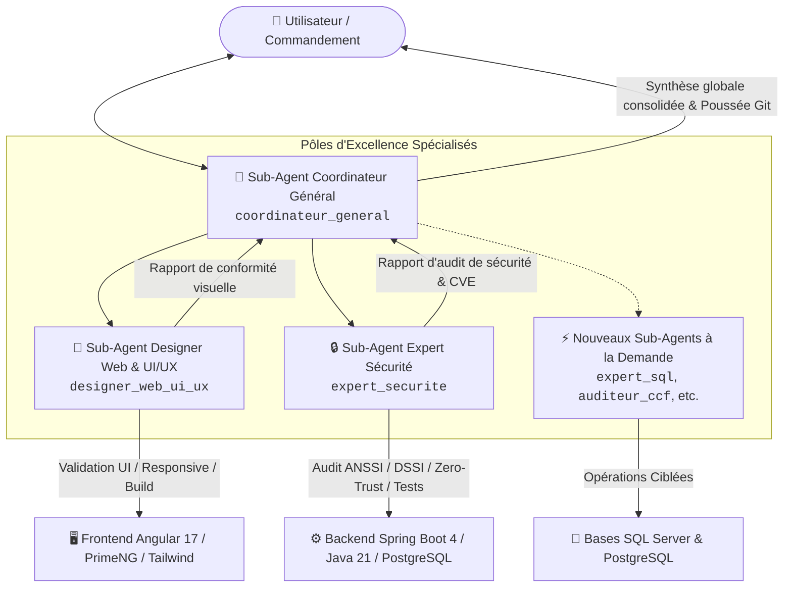
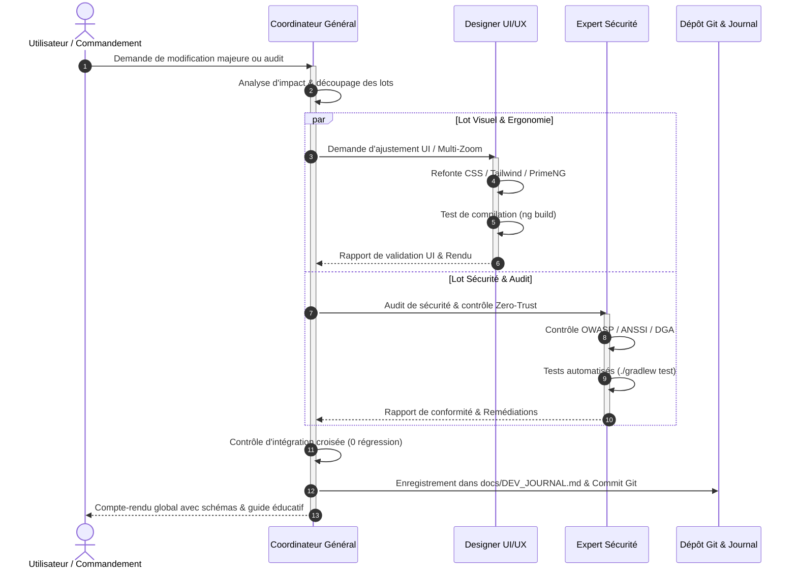

# 🛡️ Architecture & Gouvernance Multi-Agents — GAMMA 3.0

Ce document formalise l'organisation, les rôles, les compétences et les protocoles de communication des trois sous-agents spécialisés configurés pour la conduite, la sécurisation et la modernisation du système **GAMMA 3.0** (Marine Nationale Tunisienne).

---

## 1. Vue d'Ensemble du Collège d'Agents

L'organisation repose sur un modèle hiérarchique avec séparation stricte des responsabilités (SoD - *Separation of Duties*) :

---

## 2. Fiches de Rôle des Sous-Agents

### 🎨 A. Sub-Agent Designer Web & UI/UX (`designer_web_ui_ux`)
* **Identifiant technique :** `designer_web_ui_ux`
* **Domaine d'expertise :** Ergonomie militaire, Responsive Web Design, Design System (Angular 17, TailwindCSS, PrimeNG 17).
* **Missions fondamentales :**
  1. **Résilience multi-résolution et multi-zoom :** Garantir un affichage impeccable sous les niveaux de zoom **90%, 100%, 110%, 125% et 150%**, et sur les résolutions de 1366x768 à l'Ultra HD 4K.
  2. **Immunisation anti-coupure :** Systématiser le balisage `whitespace-nowrap shrink-0` sur tous les titres critiques, badges et boutons pour empêcher tout retour à la ligne anarchique.
  3. **Architecture à 2 paliers :** Transformer toute barre d'actions encombrée (> 5 contrôles) en un en-tête dégagé (Ligne 1 : Titre + Action principale ; Ligne 2 : Filtres et recherches alignés).
  4. **Validation technique :** Exécuter systématiquement `npm run build` dans `gamma3-frontend/` après chaque ajustement visuel.
* **Outils alloués :** Outils d'écriture et d'édition de fichiers, exploration du code, outils MCP.

---

### 🔒 B. Sub-Agent Expert Sécurité (`expert_securite`)
* **Identifiant technique :** `expert_securite`
* **Domaine d'expertise :** Sécurité applicative, durcissement d'infrastructures (standards ANSSI, DGA, DSSI, OWASP Top 10, CWE).
* **Missions fondamentales :**
  1. **Contrôle d'accès & Cloisonnement (OWASP A01 / Zero-Trust) :** Vérification systématique des annotations `@PreAuthorize`, des contrôles de sections (`AccesDAUtil.estAutorise`) et de la stricte étanchéité géographique des magasins (SGS, SM1, Sud).
  2. **Information Disclosure & Exceptions (CWE-209 / OWASP A05) :** Veille stricte sur `GlobalExceptionHandler` pour interdire toute fuite de trace SQL, de nom de table ou de pile d'appel dans les réponses API.
  3. **Sécurité des chemins & uploads (CWE-22) :** Vérification du rejet des séquences `..` et du confinement des chemins via `Path.normalize().startsWith(baseDir)`.
  4. **Élimination des métadonnées obsolètes :** Traque et éradication des mentions temporaires ("TODO", "Sprint X", mocks, secrets en clair).
  5. **Validation par tests automatisés :** Maintien au vert de `./gradlew test` et émission de matrices de conformité de sécurité.
* **Outils alloués :** Outils d'écriture et d'édition de fichiers, exploration du code, outils MCP.

---

### 👑 C. Sub-Agent Coordinateur Général (`coordinateur_general`)
* **Identifiant technique :** `coordinateur_general`
* **Domaine d'expertise :** Direction technique, orchestration multi-agents, arbitrage de cohérence globale et gouvernance de projet.
* **Missions fondamentales :**
  1. **Pilotage de l'équipe :** Assigner les directives de l'utilisateur au `designer_web_ui_ux` ou à l'`expert_securite` en formulant des prompts clairs avec critères de succès vérifiables.
  2. **Instanciation dynamique :** Faculté exclusive de définir et de lancer de **nouveaux sous-agents** (`EnableSubagentTools: true`) si un périmètre spécifique l'exige.
  3. **Arbitrage ergonomie / sécurité :** Concilier les impératifs du Zero-Trust UI (masquage strict selon les privilèges) avec une disposition graphique équilibrée sans trous visuels.
  4. **Contrôle de validation croisée :** Vérification que la chaîne entière est stable (`./gradlew test` et `npm run build` réussis à 100%).
  5. **Compte-rendu unifié :** Restitution de rapports clairs avec schémas Mermaid et conformité au *Protocole de Documentation Éducative*.
* **Outils alloués :** Outils d'orchestration de sous-agents (`define_subagent`, `invoke_subagent`, `send_message`, `manage_subagents`), outils d'écriture, outils MCP.

---

## 3. Matrice d'Interaction et Protocole d'Exécution

---

## 4. Guide d'Utilisation Immédiat

Pour déclencher une mission par l'intermédiaire de ces sous-agents :
* **Délégation au Coordinateur :** Vous pouvez confier une demande complète au `coordinateur_general`, qui pilotera lui-même le Designer et l'Expert Sécurité.
* **Intervention Directe :** Vous pouvez également solliciter directement le `designer_web_ui_ux` pour un écran spécifique ou l'`expert_securite` pour un audit de vulnérabilité.
