# Architecture de la Base de Données — GAMMA 3

**Document de passation pour l'équipe de développement**
Rédigé le 2026-09-09 · À lire avant toute intervention sur le schéma de données.

> Ce document décrit l'état RÉEL du schéma tel qu'il est généré par le code (JPA/Hibernate),
> et non un schéma théorique. Chaque affirmation ci-dessous a été vérifiée directement dans
> le code source des entités (`gamma3-backend/src/main/java/tn/defense/gamma3/**/domain/*.java`)
> le jour de la rédaction — pas de suppositions, pas de recopie de la documentation CCF.
> Si le code et ce document divergent un jour, **le code fait foi** : merci de corriger ce
> document en conséquence (voir section 10, Recommandations).

---

## 1. Vue d'ensemble

### 1.1 Pile technique

| Composant | Technologie | Détail |
|---|---|---|
| Base de données applicative | PostgreSQL 16 | `gamma3_db`, port `5433` en local (docker-compose) |
| ORM | JPA / Hibernate (Spring Data JPA) | Spring Boot 3.x, Java 21 |
| Génération du schéma | **`spring.jpa.hibernate.ddl-auto: update`** | ⚠️ Voir section 6.6 — pas d'outil de migration versionnée |
| Base legacy (lecture seule) | SQL Server 2019 | `Gamma2`, port `1434`, accès JDBC direct depuis le backend |
| Build | Gradle | `gamma3-backend/build.gradle` |
| Frontend | Angular + PrimeNG | Consomme l'API REST du backend, aucun accès direct à la base |

### 1.2 Comment le schéma est produit

Il n'existe **aucun fichier SQL de migration** dans ce projet (pas de Flyway, pas de Liquibase,
pas de dossier `db/migration`). Le schéma PostgreSQL est entièrement dérivé, au démarrage du
backend, des annotations JPA posées sur les classes `@Entity` listées dans ce document, grâce
au mode `ddl-auto: update` d'Hibernate. Concrètement :

- Ajouter un champ à une entité Java **ajoute automatiquement la colonne correspondante**
  dans la base au prochain redémarrage du backend (nullable par défaut si le champ existant
  contient déjà des lignes, même si l'annotation dit `nullable = false` — Hibernate ne
  rétro-remplit jamais une colonne `NOT NULL` sur des lignes existantes).
- Renommer ou supprimer un champ Java **ne renomme ni ne supprime rien côté base** — la
  colonne orpheline reste en place indéfiniment. C'est le mécanisme exact qui explique
  pourquoi ce document doit être relu à chaque changement de schéma (voir section 10).
- C'est également ce mécanisme qui a permis, dans ce projet, d'ajouter à chaud les colonnes
  `enabled`, `unite_id` et `fonction_unite` sur la table `users` sans écrire une seule ligne
  de SQL (voir `docs/DEV_JOURNAL.md`, entrées du 2026-09-04).

### 1.3 Organisation du code (package = domaine métier = préfixe de table, généralement)

```
tn.defense.gamma3
├── auth/domain          → users (+ enums Role, FonctionUnite)
├── catalogue/domain      → items, item_documents (+ enums DangerClass, TypeConsommabilite)
├── stock/domain          → magasins, stocks, mouvements_stock (+ enum TypeMouvement)
├── tiers/domain          → unites_utilisatrices, fournisseurs, marches,
│                            commandes_fournisseur, demande_dotation, plan_armement
│                            (+ enums StatutFournisseur, StatutMarche, StatutCommandeFournisseur)
├── distribution/domain   → demandes_materiel, lignes_demande, bons_sortie
│                            (+ enum StatutDemande)
├── reception/domain      → bpr, lignes_reception, pv_commission, bons_entree
│                            (+ enums StatutBPR, DecisionPv)
├── reforme/domain        → dossiers_reforme, lignes_reforme
├── notification/domain   → notifications
└── migration/            → pas d'entité — services d'ETL vers/depuis Gamma2 (section 7)
```

**22 entités `@Entity`, 11 enums.** La liste ci-dessus est exhaustive (vérifiée par
`grep -rl "@Entity"` et `grep -rl "public enum"` sur l'ensemble du backend).

---

## 2. Conventions de nommage observées

- **Tables** : `snake_case`, pluriel (`items`, `magasins`, `bons_sortie`)... avec deux
  exceptions notables à connaître : `bpr` (singulier, table `BonProvisoireReception`) et
  `pv_commission` (singulier, table `PvCommission`). Aucune règle stricte n'est appliquée par
  le code — chaque `@Table(name = "...")` est écrit à la main.
- **Colonnes** : `snake_case`, dérivé du nom de champ Java (`dateDemande` → `date_demande`)
  soit implicitement (convention Hibernate par défaut), soit explicitement via
  `@Column(name = "...")`.
- **Clés étrangères** : suffixe `_id` (`item_id`, `magasin_id`, `unite_id`...). Exception à
  surveiller : `BonSortie.magasinId` est stocké comme un simple `Long` **sans relation JPA**
  (`@Column`, pas `@ManyToOne`) — voir section 6.7, incohérence à corriger.
- **Clés primaires** : `id`, type `Long` avec `GenerationType.IDENTITY` pour 20 entités sur
  22. Exceptions : `Item` et `ItemDocument` utilisent un `UUID` avec `GenerationType.UUID`
  (probablement pour permettre l'attribution d'identifiants côté client avant la mise en base
  — hypothèse non confirmée dans le code, à vérifier avec l'auteur d'origine si possible).
- **Horodatage** : deux conventions coexistent selon l'entité — `@PrePersist`/`@PreUpdate`
  manuels (la majorité des entités) et `@CreationTimestamp`/`@UpdateTimestamp` d'Hibernate
  (`Item` uniquement). Les deux produisent le même résultat ; privilégier
  `@CreationTimestamp`/`@UpdateTimestamp` pour tout nouveau code (moins de risque d'oubli).

---

## 3. Diagramme Entité-Relation complet

```mermaid
erDiagram
    USERS ||--o{ USERS : ""
    MAGASINS ||--o{ USERS : "gestionnaires DA_MANAGER"
    UNITES_UTILISATRICES ||--o{ USERS : "comptes Gestionnaire + Commandant"

    UNITES_UTILISATRICES ||--o{ PLAN_ARMEMENT : "dotations"
    ITEMS ||--o{ PLAN_ARMEMENT : ""
    UNITES_UTILISATRICES ||--o{ DEMANDE_DOTATION : "demandes d'augmentation"
    ITEMS ||--o{ DEMANDE_DOTATION : ""
    UNITES_UTILISATRICES ||--o{ DEMANDES_MATERIEL : "demandes de distribution"
    MAGASINS ||--o{ DEMANDES_MATERIEL : "magasin désigné (routage)"
    DEMANDES_MATERIEL ||--o{ LIGNES_DEMANDE : ""
    ITEMS ||--o{ LIGNES_DEMANDE : ""
    DEMANDES_MATERIEL |o--o| BONS_SORTIE : "bon généré si approuvée"

    ITEMS ||--o{ ITEM_DOCUMENTS : "photos / docs techniques"
    ITEMS ||--o{ STOCKS : ""
    MAGASINS ||--o{ STOCKS : ""
    ITEMS ||--o{ MOUVEMENTS_STOCK : ""
    MAGASINS ||--o{ MOUVEMENTS_STOCK : ""
    USERS ||--o{ MOUVEMENTS_STOCK : "créé par (traçabilité)"

    FOURNISSEURS ||--o{ MARCHES : ""
    FOURNISSEURS ||--o{ COMMANDES_FOURNISSEUR : ""
    MARCHES |o--o{ COMMANDES_FOURNISSEUR : "optionnel (hors marché possible)"
    FOURNISSEURS ||--o{ BPR : ""
    COMMANDES_FOURNISSEUR |o--o{ BPR : "optionnel"
    MAGASINS ||--o{ BPR : ""
    BPR ||--o{ LIGNES_RECEPTION : ""
    ITEMS ||--o{ LIGNES_RECEPTION : ""
    BPR ||--|| PV_COMMISSION : "1 PV par BPR"
    PV_COMMISSION ||--|| BONS_ENTREE : "1 BE par PV"

    UNITES_UTILISATRICES ||--o{ DOSSIERS_REFORME : ""
    DOSSIERS_REFORME ||--o{ LIGNES_REFORME : ""
    ITEMS ||--o{ LIGNES_REFORME : ""

    USERS {
        Long id PK
        String matricule UK
        String password "bcrypt, JsonIgnore"
        String fullName
        Role role "ADMIN / DA_MANAGER / UNIT_USER"
        Long magasin_id FK "nullable, DA_MANAGER seulement"
        Long unite_id FK "nullable, UNIT_USER seulement"
        FonctionUnite fonction_unite "GESTIONNAIRE / COMMANDANT, nullable"
        boolean two_factor_enabled
        String secret_2fa
        boolean enabled "blocage réversible du compte"
    }
    MAGASINS {
        Long id PK
        String code UK
        String nom
        String localisation
    }
    UNITES_UTILISATRICES {
        Long id PK
        String code UK
        String nom
        String baseNavale
        String logoUrl
    }
    ITEMS {
        UUID id PK
        String nomenclature UK "12 car., encodée (voir 6.1)"
        String designation
        BigDecimal prixUnitaire
        BigDecimal stockSecurite
        String uniteGestionCode
        DangerClass dangerClass
        TypeConsommabilite typeConsommabilite
    }
    ITEM_DOCUMENTS {
        UUID id PK
        String fileName
        String fileUrl
        UUID item_id FK
    }
    STOCKS {
        Long id PK
        UUID item_id FK
        Long magasin_id FK
        BigDecimal quantite
        String emplacement
        String rayon
    }
    MOUVEMENTS_STOCK {
        Long id PK
        String referenceBon
        TypeMouvement typeMouvement
        UUID item_id FK
        Long magasin_id FK
        BigDecimal quantite
        LocalDate dateMouvement
        String motif
        Long cree_par FK "→ users, obligatoire"
    }
    PLAN_ARMEMENT {
        Long id PK
        Long unite_id FK
        UUID item_id FK
        BigDecimal quantiteType "plafond autorisé"
        BigDecimal quantiteReelle "en service"
        BigDecimal quantiteVirtuelle "réservé par demandes en cours"
    }
    DEMANDE_DOTATION {
        Long id PK
        Long unite_id FK
        UUID item_id FK
        BigDecimal quantiteType "augmentation demandée"
        String statut "SOUMISE/APPROUVEE/REJETEE, String brut"
        String motifRefus
    }
    DEMANDES_MATERIEL {
        Long id PK
        String numeroDemande UK
        LocalDate dateDemande
        StatutDemande statut
        String motifRefus
        String motifEscalade
        Long unite_id FK
        Long magasin_designe_id FK "nullable, routage géo"
        Long bon_sortie_id FK "nullable, OneToOne"
    }
    LIGNES_DEMANDE {
        Long id PK
        UUID item_id FK
        BigDecimal quantiteDemandee
        BigDecimal quantiteAccordee
        Long demande_id FK
    }
    BONS_SORTIE {
        Long id PK
        String numeroBs UK
        LocalDate dateSortie
        String transporteur
        String vehiculeMatricule
        String statut "PREPARE/LIVRE, String brut"
        Long magasin_id "PAS de FK JPA (voir 6.7)"
    }
    FOURNISSEURS {
        Long id PK
        String code UK
        String nom
        String matriculeFiscal
        StatutFournisseur statut
        Integer note "0-10"
    }
    MARCHES {
        Long id PK
        String numeroMarche UK
        String designation
        BigDecimal montantTotalHt
        BigDecimal montantTotalTtc
        LocalDate dateDebut
        LocalDate dateFin
        Long fournisseur_id FK "obligatoire"
        StatutMarche statut
    }
    COMMANDES_FOURNISSEUR {
        Long id PK
        String numeroCommande UK
        LocalDate dateCommande
        BigDecimal montantTotal
        Long fournisseur_id FK "obligatoire"
        Long marche_id FK "optionnel, hors marché possible"
        StatutCommandeFournisseur statut
    }
    BPR {
        Long id PK
        String numeroBpr UK
        LocalDate dateReception
        StatutBPR statut
        Long fournisseur_id FK "obligatoire"
        Long commande_id FK "optionnel"
        Long magasin_id FK "obligatoire"
    }
    LIGNES_RECEPTION {
        Long id PK
        Long bpr_id FK
        UUID item_id FK
        BigDecimal quantiteLivree
        BigDecimal prixUnitaire
    }
    PV_COMMISSION {
        Long id PK
        String numeroPv UK
        LocalDate dateCommission
        String membres
        DecisionPv decision
        String observations
        Long bpr_id FK "OneToOne, obligatoire, unique"
    }
    BONS_ENTREE {
        Long id PK
        String numeroBe UK
        LocalDate dateEntree
        Long pv_id FK "OneToOne, obligatoire, unique"
    }
    DOSSIERS_REFORME {
        Long id PK
        String numeroDossier UK
        LocalDate dateDemande
        Long unite_id FK
        String statut "String brut"
        String decisionCommission
        LocalDate dateCommission
    }
    LIGNES_REFORME {
        Long id PK
        Long dossier_reforme_id FK
        UUID item_id FK
        BigDecimal quantite
    }
```



> **Note de lecture du diagramme** : `NOTIFICATIONS` (table `notifications`) est
> intentionnellement absente de ce schéma ER — elle ne porte **aucune clé étrangère réelle**
> (voir section 4.9), c'est une table de messages faiblement couplée au reste du modèle.

---

## 4. Référence détaillée par domaine

Chaque section ci-dessous documente : la table, ses colonnes (nom, type, contrainte),
ses relations, et — quand c'est pertinent — la logique métier qui n'apparaît nulle part
dans le DDL généré et que le code seul explique.

### 4.1 Domaine `auth` — Comptes et accès

#### `users` (entité `User`, implémente `UserDetails` de Spring Security)

| Colonne | Type | Contrainte | Rôle |
|---|---|---|---|
| `id` | `bigint` | PK, IDENTITY | |
| `matricule` | `varchar(50)` | UNIQUE, NOT NULL | Identifiant de connexion |
| `password` | `varchar` | NOT NULL | Hash bcrypt — jamais sérialisé (`@JsonIgnore`) |
| `full_name` | `varchar(100)` | NOT NULL | |
| `role` | `varchar` (enum STRING) | NOT NULL | `ADMIN` / `DA_MANAGER` / `UNIT_USER` |
| `magasin_id` | `bigint` FK → `magasins` | nullable | Non-null uniquement pour `DA_MANAGER` |
| `unite_id` | `bigint` FK → `unites_utilisatrices` | nullable | Non-null uniquement pour `UNIT_USER` |
| `fonction_unite` | `varchar` (enum STRING) | nullable | `GESTIONNAIRE` / `COMMANDANT`, `UNIT_USER` seulement |
| `two_factor_enabled` | `boolean` | défaut `false` | |
| `secret_2fa` | `varchar(32)` | nullable | Secret TOTP |
| `enabled` | `boolean` | défaut `true` | Blocage réversible (voir 6.4) |

**Règles non visibles dans le DDL** :
- Un compte `UNIT_USER` doit porter à la fois `unite` et `fonction_unite` — non imposé au
  niveau base (les deux colonnes sont nullable pour permettre `ADMIN`/`DA_MANAGER`), imposé
  uniquement par la validation applicative de `UserAdminController`.
- Un seul compte **actif** (`enabled = true`) par couple `(unite_id, fonction_unite)` — règle
  purement applicative (`UserAdminController`), **aucune contrainte unique en base** ne
  l'empêche. Un bug applicatif futur pourrait donc créer deux Commandants actifs pour la
  même unité sans qu'aucune erreur SQL ne se déclenche.

#### `Role` (enum, non persisté comme table — stocké en `varchar` dans `users.role`)
`ADMIN` (administrateur système) · `DA_MANAGER` (gestionnaire GAMMA3, un par magasin) ·
`UNIT_USER` (compte d'unité militaire — Gestionnaire ou Commandant, voir `FonctionUnite`).

#### `FonctionUnite` (enum)
`GESTIONNAIRE` (compose et soumet les demandes) · `COMMANDANT` (valide/refuse avant GAMMA3,
ne crée jamais de demande lui-même). Introduit le 2026-09-04 pour le workflow à double
vérification (voir section 6.2).

---

### 4.2 Domaine `catalogue` — Référentiel articles

#### `items` (entité `Item`) — **63 283 lignes** au dernier audit, table centrale du système

| Colonne | Type | Contrainte | Rôle |
|---|---|---|---|
| `id` | `uuid` | PK, `GenerationType.UUID` | ⚠️ Seule entité (avec `ItemDocument`) à ne pas utiliser `Long`/`IDENTITY` |
| `nomenclature` | `varchar(12)` | UNIQUE, NOT NULL | Code encodé, voir 6.1 |
| `designation` | `varchar(254)` | nullable | |
| `prix_unitaire` | `numeric(18,3)` | nullable | |
| `stock_securite` | `numeric(10,2)` | nullable | Seuil d'alerte |
| `unite_gestion_code` | `varchar(2)` | nullable | |
| `photo_url` | `varchar` | nullable | |
| `technical_doc_url` | `varchar` | nullable | |
| `danger_class` | `varchar` (enum STRING) | nullable | Voir `DangerClass` |
| `type_consommabilite` | `varchar(20)` | NOT NULL, défaut `'CONSOMMABLE'` | Voir `TypeConsommabilite` |
| `created_at` | `timestamp` | non modifiable | `@CreationTimestamp` |
| `updated_at` | `timestamp` | | `@UpdateTimestamp` |

Relation `1—N` vers `item_documents` (cascade `ALL` + `orphanRemoval = true` : supprimer un
`Item` supprime tous ses documents attachés).

**La nomenclature n'est PAS normalisée en colonnes séparées.** C'est une chaîne de 12
caractères, décodée à la volée par des méthodes calculées (`getClasseCode()`,
`getSousClasseCode()`, `getCategorieCode()`, `getSerieCode()`, `getItemCode()` — toutes via
`substring()`). Détail complet en section 6.1.

#### `item_documents` (entité `ItemDocument`)

| Colonne | Type | Contrainte |
|---|---|---|
| `id` | `uuid` | PK |
| `file_name` | `varchar` | NOT NULL |
| `file_url` | `varchar` | NOT NULL |
| `item_id` | `uuid` FK → `items` | NOT NULL |

#### `DangerClass` (enum)
`NONE`, `EXPLOSIVE`, `FLAMMABLE`, `TOXIC`, `CORROSIVE`, `RADIOACTIVE`,
`ENVIRONMENTAL_HAZARD`, `OXIDIZING`, `COMPRESSED_GAS`, `HARMFUL`.

#### `TypeConsommabilite` (enum)
`CONSOMMABLE` (quantité uniquement) · `NON_CONSOMMABLE` (suit un cycle de vie
`NEUF → EN_SERVICE → MAINTENANCE → RÉFORME`, documenté dans le Javadoc de l'enum mais **ce
cycle de vie n'est actuellement matérialisé nulle part dans le schéma** — aucune colonne
`etat`/`cycle_vie` sur `Item` ni sur `Stock` ne le trace à ce jour. À clarifier avec le métier
si le suivi individuel d'un bien non-consommable (par numéro de série, par exemple) est
attendu.

---

### 4.3 Domaine `stock` — Stocks physiques et mouvements

#### `magasins` (entité `Magasin`)
`id` (PK) · `code` (UNIQUE, NOT NULL) · `nom` · `localisation`. Table de référence simple,
4 magasins connus en pratique (`SGS`, `SM1`, `SM2`, `M_MEC`, voir `DataSeeder`).

#### `stocks` (entité `Stock`)

| Colonne | Type | Contrainte |
|---|---|---|
| `id` | `bigint` | PK |
| `item_id` | `uuid` FK → `items` | |
| `magasin_id` | `bigint` FK → `magasins` | |
| `quantite` | `numeric(19,4)` | |
| `emplacement` | `varchar` | |
| `rayon` | `varchar` | |

**Contrainte unique composite** `(item_id, magasin_id)` — un article ne peut avoir qu'**une
seule** ligne de stock par magasin (le cumul se fait en modifiant `quantite`, jamais en
ajoutant une nouvelle ligne).

#### `mouvements_stock` (entité `MouvementStock`) — journal d'audit des stocks

| Colonne | Type | Contrainte |
|---|---|---|
| `id` | `bigint` | PK |
| `reference_bon` | `varchar` | |
| `type_mouvement` | `varchar` (enum) | Voir `TypeMouvement` |
| `item_id` | `uuid` FK → `items` | |
| `magasin_id` | `bigint` FK → `magasins` | |
| `quantite` | | |
| `date_mouvement` | `date` | |
| `motif` | `varchar` | |
| `cree_par` | `bigint` FK → `users` | **NOT NULL** — traçabilité obligatoire |

Chaque mouvement de stock doit obligatoirement être rattaché à l'utilisateur qui l'a
déclenché — exigence de traçabilité militaire déjà en place dans le modèle actuel, à
préserver dans toute évolution future de ce module.

#### `TypeMouvement` (enum)
`ENTREE`, `SORTIE`, `INVENTAIRE`, `REFORME`.

---

### 4.4 Domaine `tiers` — Unités, fournisseurs, marchés, dotations

#### `unites_utilisatrices` (entité `UniteUtilisatrice`)
`id` (PK) · `code` (UNIQUE, NOT NULL) · `nom` · `baseNavale` · `logoUrl` ·
`planCount` (`@Transient` — calculé à la volée pour la réponse JSON, **jamais persisté**,
ne pas chercher de colonne correspondante en base).

#### `fournisseurs` (entité `Fournisseur`)
`id` (PK) · `code` (UNIQUE) · `nom` · `matriculeFiscal` · `adresse` · `contactNom` ·
`telephone` · `email` · `fax` · `note` (`Integer`, /10) · `logoUrl` ·
`statut` (`StatutFournisseur`, défaut `PROSPECT`) · `createdAt`.

#### `StatutFournisseur` (enum)
`PROSPECT` → `EN_EVALUATION` → `HOMOLOGUE` (ou `SUSPENDU` à tout moment). Cycle de vie
purement applicatif, aucune contrainte de transition imposée en base.

#### `marches` (entité `Marche`)
`id` (PK) · `numeroMarche` (UNIQUE) · `designation` · `montantTotalHt`/`montantTotalTtc`
(`numeric(19,4)`) · `dateDebut`/`dateFin` · `fournisseur_id` FK **obligatoire** ·
`statut` (`StatutMarche`, défaut `ACTIF`) · `createdAt`.

#### `StatutMarche` (enum)
`ACTIF`, `CLOTURE`.

#### `commandes_fournisseur` (entité `CommandeFournisseur`)
`id` (PK) · `numeroCommande` (UNIQUE) · `dateCommande` · `montantTotal` ·
`fournisseur_id` FK **obligatoire** · `marche_id` FK **optionnel** (une commande peut être
passée hors marché — commentaire explicite dans le code) ·
`statut` (`StatutCommandeFournisseur`, défaut `EN_ATTENTE`) · `createdAt`.

#### `StatutCommandeFournisseur` (enum)
`EN_ATTENTE`, `LIVRE`, `ANNULE`.

#### `demande_dotation` (entité `DemandeDotation`)

⚠️ **À ne pas confondre avec `demandes_materiel`** (section 4.5) — deux entités distinctes
qui répondent à deux besoins différents. Voir l'encadré comparatif en fin de section 4.5.

| Colonne | Type | Contrainte |
|---|---|---|
| `id` | `bigint` | PK |
| `unite_id` | `bigint` FK → `unites_utilisatrices` | obligatoire |
| `item_id` | `uuid` FK → `items` | obligatoire |
| `quantite_type` | `numeric` | plafond de dotation **demandé** (augmentation) |
| `statut` | `varchar` | **chaîne brute**, pas un enum JPA : `SOUMISE` / `APPROUVEE` / `REJETEE` (valeurs documentées en commentaire Java uniquement) |
| `motif_refus` | `TEXT` | |
| `created_at` | | `@PrePersist` |

#### `plan_armement` (entité `PlanArmement`) — le référentiel des dotations en vigueur

| Colonne | Type | Contrainte |
|---|---|---|
| `id` | `bigint` | PK |
| `unite_id` | `bigint` FK → `unites_utilisatrices` | obligatoire |
| `item_id` | `uuid` FK → `items` | obligatoire |
| `quantite_type` | `numeric(12,2)` | défaut `0` — plafond **autorisé** |
| `quantite_reelle` | `numeric(12,2)` | défaut `0` — quantité actuellement en service |
| `quantite_virtuelle` | `numeric(12,2)` | défaut `0` — quantité **réservée** par des demandes en cours (voir 6.3) |
| `updated_at` | | `@PrePersist`/`@PreUpdate` |

**Contrainte unique composite** `(unite_id, item_id)` — une seule ligne de dotation possible
par couple unité/article.

---

### 4.5 Domaine `distribution` — Demandes de matériel et sorties

#### `demandes_materiel` (entité `DemandeMateriel`) — cœur du workflow de double validation

| Colonne | Type | Contrainte |
|---|---|---|
| `id` | `bigint` | PK |
| `numero_demande` | `varchar` | UNIQUE, NOT NULL |
| `date_demande` | `date` | NOT NULL |
| `statut` | `varchar` (enum STRING) | NOT NULL — voir `StatutDemande` |
| `motif_refus` | `TEXT` | Renseigné par le Commandant OU par GAMMA3 selon le point de refus |
| `unite_id` | `bigint` FK → `unites_utilisatrices` | obligatoire |
| `magasin_designe_id` | `bigint` FK → `magasins` | **nullable** — renseigné seulement après validation du Commandant, par l'algorithme de routage géographique |
| `motif_escalade` | `TEXT` | Renseigné par le DA_MANAGER en cas d'escalade vers l'ADMIN (stock local insuffisant) |
| `bon_sortie_id` | `bigint` FK → `bons_sortie` | `OneToOne`, nullable |
| — | `1—N` | vers `lignes_demande` (cascade `ALL` + `orphanRemoval`) |
| `created_at` | | `@PrePersist` |

#### `lignes_demande` (entité `LigneDemande`)
`id` (PK) · `item_id` FK **obligatoire** · `quantite_demandee` (`numeric(12,2)`, NOT NULL) ·
`quantite_accordee` (`numeric(12,2)`, nullable — renseignée à l'arbitrage) ·
`demande_id` FK **obligatoire** vers `demandes_materiel`.

#### `bons_sortie` (entité `BonSortie`)

| Colonne | Type | Contrainte |
|---|---|---|
| `id` | `bigint` | PK |
| `numero_bs` | `varchar` | UNIQUE, NOT NULL |
| `date_sortie` | `date` | NOT NULL |
| `transporteur` | `varchar` | |
| `vehicule_matricule` | `varchar` | |
| `statut` | `varchar(20)` | **chaîne brute** : `PREPARE` / `LIVRE`, défaut `PREPARE` |
| `magasin_id` | `bigint` | ⚠️ **simple colonne, PAS une relation JPA** (voir 6.7) |

#### `StatutDemande` (enum) — le cycle de vie le plus complexe du système

```
EN_ATTENTE_VALIDATION_COMMANDANT ──(refus)──► REFUSE_COMMANDANT          [jamais vu par GAMMA3]
        │ (validation Commandant)
        ▼
      SOUMIS
        │ (prise en charge DA_MANAGER)
        ▼
  EN_COURS_ARBITRAGE ──(stock local insuffisant)──► ESCALADE_SGS
        │                                                  │
        ├──(refus DA_MANAGER/ADMIN)──► REFUSE               │ (validation ADMIN)
        │                                                  ▼
        ├──────────────────────────────────► APPROUVE_PARTIEL / APPROUVE_TOTAL
        │                                                  │
        ▼                                                  ▼
                                                          LIVRE
```

Détail complet du workflow de double vérification en section 6.2.

> **Encadré — `DemandeDotation` vs `DemandeMateriel`, ne pas confondre**
>
> | | `DemandeDotation` | `DemandeMateriel` |
> |---|---|---|
> | Table | `demande_dotation` | `demandes_materiel` |
> | Objet de la demande | Augmenter le **plafond** (`quantiteType`) du Plan d'Armement lui-même | Obtenir une **distribution physique** d'un article, dans la limite du plafond déjà accordé |
> | Statut | `String` brut (`SOUMISE`/`APPROUVEE`/`REJETEE`) | Enum `StatutDemande`, cycle à 9 états |
> | Workflow de double validation Gestionnaire/Commandant | **Non implémenté** sur cette entité | Implémenté (section 6.2) |
> | Champ `unite`/`item` | Oui, tous deux obligatoires | Oui (`unite`), + une collection de `lignes_demande` |
>
> Le nommage très proche des deux entités (et de leurs endpoints REST associés) est une
> source de confusion documentée — voir risque en section 9.

---

### 4.6 Domaine `reception` — Réception fournisseur

Chaîne : `commandes_fournisseur` (optionnel) → `bpr` (réception provisoire) →
`lignes_reception` (détail par article) → `pv_commission` (procès-verbal de la commission de
réception) → `bons_entree` (entrée définitive en stock).

#### `bpr` (entité `BonProvisoireReception`, table **singulier**)

| Colonne | Type | Contrainte |
|---|---|---|
| `id` | `bigint` | PK |
| `numero_bpr` | `varchar` | UNIQUE, NOT NULL |
| `date_reception` | `date` | NOT NULL |
| `statut` | `varchar` (enum STRING) | NOT NULL, défaut `ATTENTE_PV` — voir `StatutBPR` |
| `fournisseur_id` | FK → `fournisseurs` | obligatoire |
| `commande_id` | FK → `commandes_fournisseur` | **optionnel** |
| `magasin_id` | FK → `magasins` | obligatoire |
| `created_at` | | `@PrePersist` |

#### `lignes_reception` (entité `LigneReception`)
`id` (PK) · `bpr_id` FK obligatoire · `item_id` FK obligatoire ·
`quantite_livree` (`numeric(12,2)`, NOT NULL) · `prix_unitaire` (`numeric(12,3)`).

#### `pv_commission` (entité `PvCommission`, table **singulier**)
`id` (PK) · `numero_pv` (UNIQUE) · `date_commission` · `membres` (`TEXT`) ·
`decision` (enum `DecisionPv`, NOT NULL) · `observations` (`TEXT`) ·
`bpr_id` FK **obligatoire, `OneToOne`, UNIQUE** (un seul PV par BPR) · `created_at`.

#### `bons_entree` (entité `BonEntree`)
`id` (PK) · `numero_be` (UNIQUE) · `date_entree` ·
`pv_id` FK **obligatoire, `OneToOne`, UNIQUE** vers `pv_commission` (un seul bon d'entrée par
PV) · `created_at`.

#### `StatutBPR` (enum)
`ATTENTE_PV`, `VALIDE`, `REJETE`.

#### `DecisionPv` (enum)
`ACCEPTE`, `ACCEPTE_AVEC_RESERVE`, `REFUSE`.

> **Lacune observée** : rien dans le code ne fait automatiquement passer une ligne de stock
> (`Stock.quantite`) ou ne crée un `MouvementStock` de type `ENTREE` au moment de la création
> d'un `BonEntree`. Si ce lien existe, il est géré ailleurs (service applicatif non couvert
> par cette lecture des entités) — **à vérifier explicitement dans la couche service avant de
> considérer que la chaîne réception → stock est automatique.**

---

### 4.7 Domaine `reforme` — Mise hors service

#### `dossiers_reforme` (entité `DossierReforme`)

| Colonne | Type | Contrainte |
|---|---|---|
| `id` | `bigint` | PK |
| `numero_dossier` | `varchar(30)` | UNIQUE, NOT NULL |
| `date_demande` | `date` | NOT NULL |
| `unite_id` | FK → `unites_utilisatrices` | obligatoire |
| `statut` | `varchar(20)` | **chaîne brute** : `BROUILLON`/`SOUMIS`/`COMMISSION`/`TRAITE`/`REJETE`, défaut `BROUILLON` |
| `motif` | `TEXT` | |
| `decision_commission` | `varchar(30)` | `REFORME_COMPLETE`/`DECLASSEMENT`/`REPARATION`/`REJETE` (chaîne brute) |
| `date_commission` | `date` | |
| `membres_commission` | `TEXT` | |
| `observations_commission` | `TEXT` | |
| `created_at` | | `@PrePersist` |

#### `lignes_reforme` (entité `LigneReforme`)
`id` (PK) · `dossier_reforme_id` FK obligatoire · `item_id` FK obligatoire ·
`quantite` (`numeric(12,3)`, NOT NULL) · `observations` (`TEXT`).

---

### 4.8 Domaine `migration` — pas d'entité persistante

Le package `migration` ne définit aucune `@Entity` : il contient uniquement des services et
contrôleurs qui lisent/écrivent via les repositories des autres domaines. Voir section 7 pour
le détail complet des mécanismes de migration Gamma2 → Gamma3.

---

### 4.9 Domaine `notification`

#### `notifications` (entité `Notification`)

| Colonne | Type | Contrainte |
|---|---|---|
| `id` | `bigint` | PK |
| `title` | `varchar` | NOT NULL |
| `message` | `varchar(1000)` | NOT NULL |
| `type` | `varchar` | NOT NULL — valeurs libres observées : `DOTATION`, `MATERIEL`, `REFORME`, `SYSTEM` (pas un enum JPA) |
| `unite_code` | `varchar` | nullable — **dénormalisé** : stocke le `code` textuel de l'unité, pas une FK vers `unites_utilisatrices.id`. `NULL` = notification pour les admins/opérateurs. |
| `reference_id` | `varchar` | nullable — identifiant **polymorphe** vers la ressource concernée (unité, demande...), stocké en texte, sans FK ni colonne de discrimination de type |
| `is_read` | `boolean` | défaut `false` |
| `created_at` | `timestamp` | défaut `now()` |

**Aucune clé étrangère réelle sur cette table.** Le couplage avec le reste du modèle est
entièrement applicatif (comparaison de chaînes sur `unite_code`, interprétation ad hoc de
`reference_id` selon `type`). Fonctionnel mais fragile : un changement du `code` d'une unité
existante casserait silencieusement le ciblage de ses notifications passées.

---

## 5. Référence rapide des 11 enums

| Enum | Package | Valeurs |
|---|---|---|
| `Role` | `auth` | `ADMIN`, `DA_MANAGER`, `UNIT_USER` |
| `FonctionUnite` | `auth` | `GESTIONNAIRE`, `COMMANDANT` |
| `DangerClass` | `catalogue` | `NONE`, `EXPLOSIVE`, `FLAMMABLE`, `TOXIC`, `CORROSIVE`, `RADIOACTIVE`, `ENVIRONMENTAL_HAZARD`, `OXIDIZING`, `COMPRESSED_GAS`, `HARMFUL` |
| `TypeConsommabilite` | `catalogue` | `CONSOMMABLE`, `NON_CONSOMMABLE` |
| `TypeMouvement` | `stock` | `ENTREE`, `SORTIE`, `INVENTAIRE`, `REFORME` |
| `StatutFournisseur` | `tiers` | `PROSPECT`, `EN_EVALUATION`, `HOMOLOGUE`, `SUSPENDU` |
| `StatutMarche` | `tiers` | `ACTIF`, `CLOTURE` |
| `StatutCommandeFournisseur` | `tiers` | `EN_ATTENTE`, `LIVRE`, `ANNULE` |
| `StatutDemande` | `distribution` | `EN_ATTENTE_VALIDATION_COMMANDANT`, `REFUSE_COMMANDANT`, `SOUMIS`, `EN_COURS_ARBITRAGE`, `ESCALADE_SGS`, `APPROUVE_PARTIEL`, `APPROUVE_TOTAL`, `REFUSE`, `LIVRE` |
| `StatutBPR` | `reception` | `ATTENTE_PV`, `VALIDE`, `REJETE` |
| `DecisionPv` | `reception` | `ACCEPTE`, `ACCEPTE_AVEC_RESERVE`, `REFUSE` |

Tous stockés en base via `@Enumerated(EnumType.STRING)` (jamais `ORDINAL`) — bonne pratique
déjà en place : réordonner les valeurs d'un enum dans le code n'a **aucun impact** sur les
données déjà enregistrées, contrairement à un stockage `ORDINAL`.

Trois entités utilisent en revanche une **chaîne `String` brute** au lieu d'un enum JPA pour
un champ de statut : `DemandeDotation.statut`, `BonSortie.statut`, `DossierReforme.statut`
(+ `.decisionCommission`). Aucune contrainte `CHECK` en base ne restreint leurs valeurs
possibles — voir recommandation en section 10.

---

## 6. Règles métier encodées hors du DDL

Cette section documente ce qu'un simple export de schéma SQL ne révèle jamais : la logique
réellement appliquée par le code Java autour de ces tables.

### 6.1 Encodage de la nomenclature (`Item.nomenclature`)

La nomenclature est une chaîne **fixe de 12 caractères**, découpée par position (et non par
séparateur) :

```
Classe(2) + SousClasse(2) + Categorie(2) + Serie(2) + ItemCode(4)  =  12 caractères
```

Décodée à la volée par des méthodes calculées (`getClasseCode()`, `getSousClasseCode()`,
`getCategorieCode()`, `getSerieCode()`, `getItemCode()`, toutes basées sur `substring()`),
**jamais stockées comme colonnes séparées**. C'est une convention Gamma3 spécifique, qui
diverge délibérément de la spécification CCF brute (1 chiffre de classe, 11 caractères au
total) — vérifié lors de l'audit CCF précédent de ce projet (voir
`docs/AUDIT_GAMMA3_2026-08-31.md`).

**Conséquence pour l'équipe entrante** : toute requête SQL directe qui doit filtrer par
classe/sous-classe/etc. doit utiliser `SUBSTRING(nomenclature, ...)` — aucun index n'existe
sur ces sous-parties (voir section 9, aucun index déclaré nulle part dans le code).

### 6.2 Workflow de double validation Gestionnaire/Commandant

Règle métier confirmée par le client le 2026-09-04 : chaque unité navigante dispose de
**deux comptes distincts**, liés via `User.unite` + `User.fonctionUnite` :

1. Le **Gestionnaire** compose et soumet une `DemandeMateriel` → statut initial
   `EN_ATTENTE_VALIDATION_COMMANDANT`. À ce stade, **aucun routage de magasin, aucune
   réservation sur le Plan d'Armement (`quantiteVirtuelle`), aucune notification au
   DA_MANAGER** n'a encore lieu — la demande est invisible de GAMMA3.
2. Le **Commandant** de la MÊME unité (`fonctionUnite == COMMANDANT`) valide ou refuse
   (`POST /demandes/{id}/valider-commandant`) :
   - Refus → statut `REFUSE_COMMANDANT` avec `motifRefus` obligatoire. La demande **n'atteint
     jamais** GAMMA3, mais reste tracée et visible du Gestionnaire de la même unité.
   - Acceptation → c'est **seulement à ce moment** que le routage de magasin, la réservation
     de dotation et la notification au DA_MANAGER sont exécutés (méthode
     `DistributionService.validerParCommandant()`), et le statut passe à `SOUMIS`.
3. À partir de `SOUMIS`, le workflow classique GAMMA3 (arbitrage DA_MANAGER, escalade SGS
   éventuelle, approbation, livraison) se déroule sans changement.

**Contrôle d'accès associé** : `GET /demandes` (vue GAMMA3) filtre explicitement les statuts
`EN_ATTENTE_VALIDATION_COMMANDANT` et `REFUSE_COMMANDANT` — aucune demande non encore validée
par le Commandant ne doit jamais apparaître dans une liste consommée par un DA_MANAGER ou un
ADMIN. **Toute nouvelle requête/rapport ajouté sur `demandes_materiel` doit reproduire ce
filtre**, sous peine de fuite d'information (une unité verrait une demande de matériel
interne d'une autre unité, jamais validée par son Commandant).

### 6.3 Mécanique de réservation du Plan d'Armement

`PlanArmement` porte trois quantités distinctes pour un couple (unité, article) :

- `quantiteType` : plafond **autorisé** (fixé par une `DemandeDotation` approuvée).
- `quantiteReelle` : quantité **effectivement en service** actuellement.
- `quantiteVirtuelle` : quantité **réservée** par des `DemandeMateriel` en cours
  (soumises mais pas encore livrées) — protège contre le sur-engagement d'une dotation
  limitée pendant qu'une demande est encore en traitement.

**Point de vigilance pour l'équipe entrante** : la réservation (`quantiteVirtuelle`) n'a lieu
qu'**à l'acceptation du Commandant** (`validerParCommandant()`), pas à la création de la
demande par le Gestionnaire. Ce choix a été fait délibérément lors de la refonte du
2026-09-04 : avant, la réservation avait lieu immédiatement à la création, ce qui aurait
bloqué inutilement de la dotation pour des demandes que le Commandant finit par refuser.

### 6.4 Blocage de compte (`User.enabled`)

- Le champ `enabled` (défaut `true`) implémente `UserDetails.isEnabled()` (généré
  automatiquement par Lombok `@Data` à partir du champ).
- Spring Security ne vérifie `isEnabled()` **que lors du login** (`DaoAuthenticationProvider`)
  — un JWT déjà émis pour un compte ensuite bloqué resterait valide jusqu'à expiration si rien
  d'autre n'était fait. Le projet corrige explicitement ce point : `JwtAuthenticationFilter`
  vérifie `userDetails.isEnabled()` à **chaque requête authentifiée**, pas seulement au login.
  **Toute réimplémentation future du filtre JWT doit conserver ce contrôle**, sous peine de
  réintroduire la faille (un compte bloqué continuerait à agir jusqu'à expiration du token).

### 6.5 Rattachement Unité/Fonction — pourquoi ce n'est pas juste `matricule = code unité`

Avant le 2026-09-04, la convention implicite était `matricule d'un compte UNIT_USER = code de
l'unité correspondante` — ce qui ne permettait qu'**un seul compte par unité**. Le passage à
deux comptes par unité (Gestionnaire + Commandant) a nécessité un rattachement explicite
(`User.unite` + `User.fonctionUnite`), avec un **backfill automatique et idempotent** dans
`DataSeeder` pour les comptes créés avant ce changement (recherche d'une `UniteUtilisatrice`
dont le `code` correspond encore au `matricule` existant). Le nouveau code (comptes créés via
`UserAdminController`) n'a plus cette contrainte de nommage — le matricule d'un Commandant
suit la convention de démonstration `<CODE_UNITE>_CDT`, mais rien ne l'impose en base.

### 6.6 Implication de `ddl-auto: update` pour l'équipe entrante

> **MISE À JOUR 2026-09-09 — Flyway introduit (étape de transition).**
> Flyway est désormais actif au démarrage du backend (`spring-boot-flyway` +
> `flyway-database-postgresql`, config dans `application.yml`). Il s'exécute **avant**
> Hibernate. Les bases déjà existantes sont marquées `baseline V0` sans rejeu ; les
> scripts vivent dans `gamma3-backend/src/main/resources/db/migration/` (`V1__…` répare
> la contrainte CHECK figée du statut des demandes — voir `DEV_JOURNAL.md` 2026-09-09).
> **`ddl-auto` reste temporairement sur `update`** : Flyway et Hibernate cohabitent
> (Flyway d'abord pour les changements explicites, Hibernate ensuite pour les entités
> pas encore couvertes par un script). Cible finale (voir §10) : écrire un baseline SQL
> complet du schéma existant puis basculer `ddl-auto` sur `validate`, afin que **toute**
> évolution passe par un script versionné. Le paragraphe ci-dessous décrit la situation
> d'origine, encore partiellement vraie tant que la transition n'est pas terminée.

**Aucun historique de migration versionné n'existait jusqu'au 2026-09-09.** Conséquences concrètes :

- Impossible de reconstruire l'état exact du schéma à une date donnée à partir du dépôt Git
  seul (contrairement à un projet Flyway/Liquibase où chaque migration est un fichier daté).
- Un déploiement sur un environnement où la base n'a jamais tourné créera le schéma correct
  au premier démarrage — mais un déploiement sur une base **déjà peuplée avec un schéma
  antérieur** dépend entièrement de la capacité d'Hibernate à ajouter les colonnes/tables
  manquantes sans erreur (ce qui fonctionne pour des ajouts simples, mais **jamais pour un
  renommage, une suppression, ou un changement de type de colonne** — ces opérations
  nécessitent un correctif SQL manuel, non tracé nulle part dans ce projet à ce jour).
- **Recommandation forte (section 10)** : introduire Flyway ou Liquibase dès que l'équipe
  reprend le projet, avant toute nouvelle évolution du schéma, pour repartir sur une base de
  migrations versionnées et rejouables — la dette technique ne fait que croître tant que
  `ddl-auto: update` reste le seul mécanisme en production.

### 6.7 Incohérence `BonSortie.magasinId`

Contrairement à toutes les autres relations vers `Magasin` dans le projet (`User.magasin`,
`Stock.magasin`, `MouvementStock.magasin`, `DemandeMateriel.magasinDesigne`, `BPR.magasin` —
toutes en `@ManyToOne`), `BonSortie.magasinId` est un simple `Long` **sans annotation JPA de
relation**. Conséquences pratiques :
- Aucune contrainte de clé étrangère en base sur cette colonne — un `magasin_id` invalide
  (orphelin) peut y être inséré sans erreur.
- Impossible de naviguer `bonSortie.getMagasin()` en Java — tout code consommateur doit
  recharger le `Magasin` lui-même via son `id`.
Probablement un oubli lors de l'écriture initiale de l'entité. **À corriger** (remplacer par
un `@ManyToOne @JoinColumn(name = "magasin_id")`) lors d'une prochaine intervention sur ce
module — non corrigé dans le cadre de cet audit pour ne pas modifier le schéma sans validation
fonctionnelle préalable de l'équipe reprenante.

---

## 7. Migrations depuis Gamma2 (SQL Server) — état des lieux exact

La reprise de données depuis Gamma2 n'a **jamais été un processus automatisé complet et
rejouable**. Deux mécanismes distincts existent, chacun migrant un sous-ensemble différent :

### 7.1 `migration/gamma2_to_gamma3.load` — script `pgloader`, exécuté manuellement, une fois

```
INCLUDING ONLY TABLE NAMES LIKE 'Item' IN SCHEMA 'dbo'
ALTER SCHEMA 'dbo' RENAME TO 'legacy'
```

Copie brute de la seule table SQL Server `dbo.Item` vers une table de préparation Postgres
`legacy.item`. **Ne touche à aucune autre table Gamma2.** Le peuplement final de la table
`items` (63 283 lignes) à partir de `legacy.item` **n'a aucune trace dans le code Java** —
`DataSeeder` ne fait que synchroniser une seule colonne (`type_consommabilite`) en supposant
que `items` est déjà peuplée. **L'insertion initiale des 63 283 lignes a donc été faite
manuellement, hors du code versionné, et n'est pas rejouable depuis ce dépôt.**

### 7.2 `PlanArmementMigrationService` — pull JDBC live, rejouable

Endpoint `POST /api/v1/migration/plan-armement` (ADMIN uniquement). Lit en direct
(connexion JDBC, pas `pgloader`) la table SQL Server `Catalogue` (quantités de Plan
d'Armement par unité/article), déduplique/agrège par `(UniteCode, nomenclature reconstruite)`,
et **remplace intégralement** la table `plan_armement` (`deleteAllInBatch()` puis
`saveAll()` — idempotent, rejouable à volonté). Ignore silencieusement (avec compteur de log)
toute ligne dont l'unité ou l'article correspondant n'existe pas déjà côté Gamma3.

### 7.2bis `MouvementMigrationService` — historique des mouvements de stock (ajouté 2026-09-09)

Endpoint `POST /api/v1/migration/mouvements-stock` (ADMIN ; bouton dans `Administration >
Audit Gamma2`). Lit en direct (JDBC) la jointure Gamma2 `dbo.LBMvt` (lignes) × `dbo.BonMvt`
(en-têtes) — ~164 000 lignes, période 2008→2026 — et insère chaque mouvement dans
`mouvements_stock` :

| Champ Gamma3 | Source Gamma2 |
|---|---|
| `item_id` | nomenclature 12 car. reconstruite (`ClasseCode`+`SousClasseCode`+`CategorieCode`+`SerieCode`+`ItemCode`), recherchée dans `items` — ligne **ignorée** si l'article n'a pas été migré (~260 cas) |
| `magasin_id` | `BonMvt.BonMvtMag` : `MDA` → **SGS** ; tout autre → SGS par défaut (Gamma2 ne connaît que 2 codes sur cette table) |
| `type_mouvement` | `BonMvt.TypeBonCode` : `D` (Distribution) → `SORTIE`, `R` (Remise) → `ENTREE` |
| `quantite` | `LBMvt.LBMvtQtitItemAcc` (quantité accordée) |
| `date_mouvement` | `BonMvt.BonMvtDate` |
| `reference_bon` | `'G2-' + BonMvtCode` |
| `motif` | `"Distribution/Remise … unité <code> — archive Gamma 2"` |
| `cree_par` | compte système `SYS-MIGRATION-G2` (rôle ADMIN mais `enabled = false`, mot de passe non-bcrypt → **connexion impossible**), créé au premier appel |

**ARCHIVES uniquement** : insertion directe dans `mouvements_stock` (pas via
`StockService.effectuerMouvement`) → **les niveaux de `stock` actuels ne sont pas modifiés**.
**Idempotent** : purge d'abord `DELETE FROM mouvements_stock WHERE reference_bon LIKE 'G2-%'`
puis réinjecte — les mouvements réels de Gamma3 (référence sans préfixe `G2-`) ne sont jamais
touchés. Insertion par lots JDBC de 1 000 (~30 s pour 164 000 lignes). Alimente la vue
« Historique » de la fiche article (`GET /api/v1/stocks/item/{id}/historique`).

### 7.3 `LegacyAuditController` — outil d'audit ajouté le 2026-09-04

Endpoint `GET /api/v1/migration/audit` (ADMIN). Puisqu'aucune trace fiable des tables Gamma2
réellement migrées n'existe dans le code, cet endpoint interroge en direct
`sys.tables`/`sys.partitions` côté SQL Server pour lister **toutes** les tables réellement
présentes dans Gamma2 avec leur nombre de lignes, et les compare aux compteurs actuels de 14
entités clés de Gamma3. **C'est l'outil de référence pour répondre à la question "que reste-
t-il dans Gamma2 qui n'a pas été repris ?"** — à utiliser (`Administration > Audit Gamma2`
côté interface) plutôt que de deviner depuis ce document, qui peut devenir obsolète si de
nouvelles tables apparaissent côté Gamma2.

### 7.4 Ce qui n'a très probablement jamais été migré

Sur la seule base de ce qui a un mécanisme de migration connu dans le code (7.1, 7.2, 7.2bis),
les données Gamma2 suivantes **n'ont toujours pas de chemin de reprise identifié** :
anciens bons de sortie (documents), anciennes réceptions (documents), anciens comptes
utilisateurs, historique détaillé des demandes de matériel (`dbo.Demande`, 721 lignes).
L'**historique des mouvements de stock** est désormais repris (voir 7.2bis). À confirmer/
infirmer table par table via `Administration > Audit Gamma2`.

---

## 8. Sécurité et audit — ce qui est déjà en place

- **Mots de passe** : hash `bcrypt` (`PasswordEncoder`), jamais sérialisé (`@JsonIgnore` sur
  `User.password`).
- **JWT** : vérifie `isEnabled()` à chaque requête (pas seulement au login, voir 6.4).
- **2FA (TOTP)** : `User.twoFactorEnabled` + `secret2fa`.
- **Traçabilité des mouvements de stock** : `MouvementStock.creePar` obligatoire (FK vers
  `User`), aucun mouvement anonyme possible.
- **Séparation des privilèges par rôle** : chaque endpoint sensible vérifie explicitement le
  `Role` (et, pour les demandes, la `FonctionUnite`) de l'appelant — pas de contrôle générique
  centralisé unique, donc **chaque nouveau contrôleur doit reproduire ce contrôle
  explicitement** (aucun mécanisme d'autorisation déclaratif de type `@PreAuthorize` unifié
  n'est systématiquement appliqué — vérifié au cas par cas selon les contrôleurs lus).
- **Dérivation de l'identité côté serveur pour les demandes** : depuis le correctif du
  2026-09-04, `POST /api/v1/demandes` dérive l'unité de la demande du compte authentifié
  (`Authentication`) et non plus d'un champ envoyé par le client — corrige une faille où
  n'importe quel compte pouvait soumettre une demande au nom de n'importe quelle unité en
  falsifiant l'`unite.id` du corps JSON. **Tout nouvel endpoint de création doit suivre le
  même principe** : ne jamais faire confiance à un identifiant d'entité métier fourni par le
  client quand cet identifiant peut être déduit du compte authentifié.

---

## 9. Lacunes et risques connus pour l'équipe entrante

| # | Sujet | Risque | Section |
|---|---|---|---|
| 1 | ~~Pas de Flyway/Liquibase~~ **Flyway introduit le 2026-09-09** ; `ddl-auto` encore sur `update` (transition) | Résiduel : tant que le baseline complet n'est pas écrit et `ddl-auto` pas passé à `validate`, Hibernate peut encore appliquer des changements de schéma non tracés | 6.6 |
| 2 | Import initial des 63 283 `Item` non rejouable, non tracé en code | Impossible de reconstruire le catalogue depuis zéro sans la sauvegarde de base actuelle | 7.1 |
| 3 | `BonSortie.magasinId` sans relation JPA | Pas de contrainte d'intégrité référentielle, navigation Java impossible | 6.7 |
| 4 | Aucun index déclaré (`@Index`) sur l'ensemble du schéma (vérifié par recherche exhaustive) | Risque de dégradation de performance sur les colonnes fréquemment filtrées (`nomenclature`, `statut`, `unite_id`, `matricule`) à mesure que le volume augmente — seules les contraintes `UNIQUE` créent un index implicite | tout le document |
| 5 | `DemandeDotation` vs `DemandeMateriel` — nommage très proche | Confusion probable pour un nouveau développeur (deux entités, deux tables, deux workflows différents portant des noms presque identiques) | 4.5 |
| 6 | Statuts en `String` brut sans enum ni contrainte `CHECK` (`DemandeDotation.statut`, `BonSortie.statut`, `DossierReforme.statut`/`.decisionCommission`) | Une valeur mal orthographiée passe silencieusement en base, aucune erreur de compilation ni de contrainte SQL pour la détecter | 5 |
| 7 | `Notification` sans FK réelle (`uniteCode` en texte, `referenceId` polymorphe non typé) | Un changement de `code` sur une `UniteUtilisatrice` existante casse silencieusement le ciblage des notifications déjà en base | 4.9 |
| 8 | Un seul compte actif par (unité, fonction) — règle purement applicative, aucune contrainte unique en base | Un bug applicatif futur pourrait créer deux Commandants actifs pour la même unité sans erreur SQL | 4.1, 6.5 |
| 9 | Chaîne réception (`BonEntree`) → mouvement de stock non confirmée dans les entités lues | Risque que la mise à jour du stock physique après réception dépende d'un service non documenté ici — à vérifier avant toute modification de ce flux | 4.6 |

---

## 10. Recommandations pour l'équipe entrante

1. ✅ **Flyway introduit le 2026-09-09** (`spring-boot-flyway`, scripts dans
   `src/main/resources/db/migration/`, `baseline-on-migrate` pour les bases existantes).
   **Reste à faire pour terminer la transition :** (a) générer le baseline SQL complet du
   schéma actuel (`pg_dump --schema-only` de la base de référence → `V0__baseline.sql` sur
   une future base neuve, ou conserver le baseline logique V0 sur les bases existantes) ;
   (b) une fois le schéma entièrement couvert par des scripts, passer
   `spring.jpa.hibernate.ddl-auto` de `update` à `validate` pour qu'Hibernate ne modifie
   plus jamais le schéma de lui-même.
2. **Ajouter les index manquants** en priorité sur : `items.nomenclature` (déjà indexé via
   `UNIQUE`, mais un index composé sur les 5 segments décodés serait utile si des filtres par
   classe/sous-classe deviennent fréquents), `demandes_materiel.statut` +
   `demandes_materiel.unite_id` (filtrés à chaque affichage de liste), `users.unite_id` +
   `users.fonction_unite` (filtrés à chaque contrôle d'accès du workflow de double validation).
3. **Corriger `BonSortie.magasinId`** en véritable `@ManyToOne` vers `Magasin`, après
   validation de l'équipe fonctionnelle (impact sur les données déjà en base à vérifier).
4. **Documenter ou refactorer les 3 champs `String` de statut restants** (`DemandeDotation`,
   `BonSortie`, `DossierReforme`) en véritables enums JPA, pour bénéficier de la vérification
   à la compilation.
5. **Ajouter une contrainte unique applicative renforcée** (ou, mieux, un index unique partiel
   PostgreSQL `WHERE enabled = true`) sur `(unite_id, fonction_unite)` de `users`, pour que la
   règle "un seul compte actif par unité/fonction" soit garantie même en cas de bug applicatif.
6. **Tenir ce document à jour à chaque modification de schéma** — c'est le seul document
   décrivant fidèlement l'état réel de la base en l'absence d'historique de migrations
   (recommandation n°1). Le protocole du projet (voir `.antigravityrules`) demande déjà une
   entrée `docs/DEV_JOURNAL.md` à chaque changement notable ; il est recommandé d'y ajouter
   systématiquement une ligne "impact schéma" pointant vers la section correspondante de ce
   document quand une entité est modifiée.
7. **Avant toute intervention sur le module Réception**, confirmer explicitement (avec le
   propriétaire du code, ou par lecture de la couche service) si la validation d'un
   `BonEntree` déclenche automatiquement une mise à jour de `Stock`/`MouvementStock` — ce
   document n'a pu le confirmer à partir des seules entités JPA (voir lacune n°9).

---

*Document rédigé pour la passation du projet GAMMA 3 à l'équipe de développement entrante.
Toute correction ou complément doit être répercuté ici en priorité, avant tout autre document,
car c'est la seule référence fidèle au schéma réel en l'absence de migrations versionnées
(voir recommandation n°1).*
